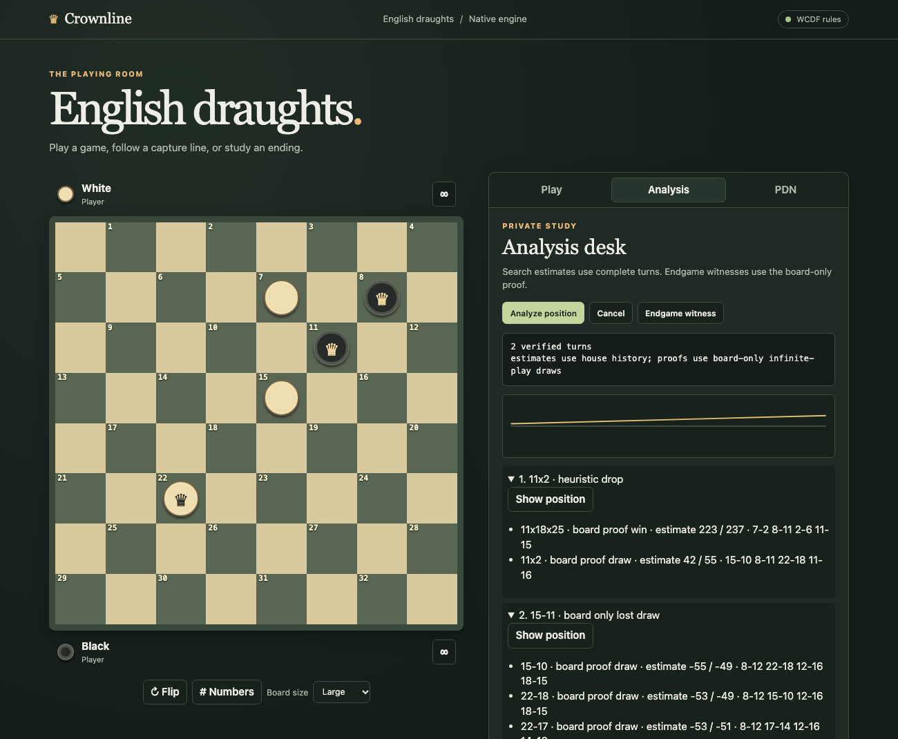

# Crownline

An original English draughts engine, browser board and endgame laboratory.

## Play and review

Use Rust 1.88.0 and Node 24.21.0. Python 3.11 or newer, OpenSSL 3 and
Graphviz support the experiment and release tools.

    make test
    make perft
    make review-demo
    make demo

Open [the local board](http://127.0.0.1:8767). Play two-player, human
against engine, engine against engine, or create a one-use room invite.
Use the PDN notebook to browse branches, then review a game from the same
record. Click, drag or use arrow keys and Enter on the board. Try
[the branching study](examples/branch-study.pdn) for both proof and
heuristic findings.

## Engine and evidence

The Rust core uses 32-square bitboards and complete capture routes.
Conservative PVS searches reversible history with bounded budgets.
The original four-piece proof uses reverse edges and a decreasing
witness rank. A separate coordinate-array generator verifies the
closed graph. Original self-play supplies the linear, sparse network
and blended experiments.

[Architecture and diagrams](docs/ARCHITECTURE.md) ·
[Rules matrix](docs/RULES_MATRIX.md) ·
[Reproduction](docs/REPRODUCIBILITY.md) ·
[Experiment plan](docs/EXPERIMENT_PLAN.md) ·
[Build status](docs/BUILD_STATUS.md)

The preview uses the classical evaluator. The closed proof uses
board-only rules. Full project acceptance remains open.
